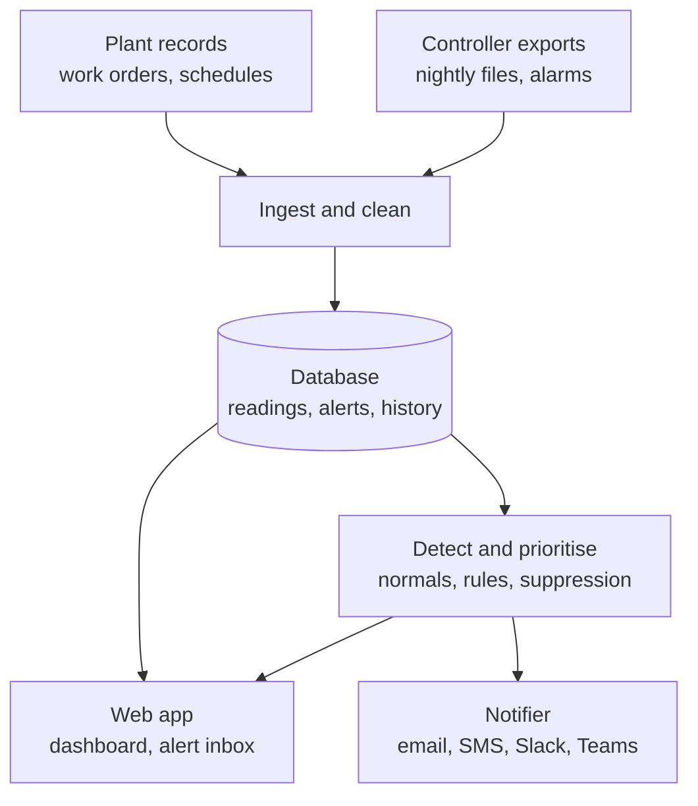

# Web App Requirements and System Design

Purpose: a tracking and notifying system the client can deploy in their own environment, to monitor refrigeration systems at three plants, rank problems by priority, and notify people when something is High or Critical. It advises people and never controls equipment.

Thresholds and times below are defaults to confirm with the client (TBC), as the PRD says.

## System design (simple)

The web app reads from the database. Only the notifier sends messages out. Nothing writes back to plant equipment.

## Priority levels

| Priority | Example trigger | Who is told | How | Response target (TBC) |
|---|---|---|---|---|
| Healthy | Reading inside its learned normal range | No one | Dashboard only | None |
| Low | Slow drift or recurring anomaly (growing 02:45 freezer spike) | Plant lead | Dashboard and daily email digest | Next day |
| Medium | One room outside its normal band, or a sensor fault needing maintenance | Plant lead and maintenance | Dashboard and daily email digest | Same shift or next business day |
| High | Food-safety room above 41 F for 30+ minutes, or many rooms warming at once | Plant manager and refrigeration tech | SMS, Slack or Teams, plus email | Acknowledge within 1 hour |
| Critical | Ammonia alarm, receiver at 0% in production, compressor trip with no backup | On-call and plant manager | SMS and phone call repeated until acknowledged | Now |

Only High and Critical send push notifications. The PRD has three alert levels (Watch, Attention, Critical). Watch is split here into Low and Medium so the levels match what the client asked for.

Two decisions for the client:
1. Does anything arrive faster than nightly? The controllers export nightly, so a Critical alert can only fire after the file arrives, which is next morning at best. Critical means "now" only with an hourly export or a live feed of controller alarms. The app should accept either.
2. Are the 41 F, 30-minute and escalation timings final?

## Functional requirements

### Monitoring and status
- R1: Overview shows all three plants: worst current priority, open alert count, last data received.
- R2: Plant page lists every room, freezer and system with status colour, current value, last update.
- R3: Point detail shows a chart of recent readings with the learned normal band, setpoint where one exists, quality flags and work-order markers.
- R4: Data-health page lists missing reports, dead or stuck sensors and outages. A gap is shown as missing and never filled with old values.

### Alerts
- R5: Every alert has priority, plant, location, start time, a plain-language explanation and evidence.
- R6: Simultaneous deviations roll up into one alert.
- R7: States are Open, Notified, Acknowledged, Resolved. Users acknowledge in the app or from the notification link, with an optional note.
- R8: An alert not acknowledged in time escalates to the next person (limits configurable per priority).
- R9: Authorised users can change priority; every change is logged with who and why.

### Notifications
- R10: High and Critical notify by SMS, Slack or Teams, and email. Critical also calls by phone until acknowledged.
- R11: Admins set an on-call roster per plant and a route per priority.
- R12: Delivery is tracked (sent, delivered, failed). A failed send falls back to the next channel.
- R13: A daily email digest lists open Low and Medium alerts and data-health issues.

### False-alarm control
- R14: Known sensor faults, planned maintenance and scheduled shutdowns never page anyone. They show as suppressed with the reason.
- R15: Admins can add a planned-maintenance window or switch a room off on purpose for a date range.
- R16: Work orders and the production and sanitation schedule suppress alerts that have a known cause.

### Data and configuration
- R17: Ingest controller export files from a watched folder or upload, in both layouts, without manual cleanup.
- R18: Setpoints and thresholds are editable per point. Plants B and C lack reliable setpoints, so setpoints are optional and the app falls back to learned normal ranges.
- R19: History export (CSV) for alerts and readings.

### Users and access
- R20: Roles: Viewer, Operator (can acknowledge), Plant manager, Admin. Users see only assigned plants.
- R21: Single sign-on if available, otherwise local accounts. Every acknowledgement and setting change is audit-logged.

## Non-functional requirements

- Deployment: containers (Docker Compose on one server is enough to start) with a standard SQL database. All data stays in the client environment; the only outbound traffic is to SMS, Slack, Teams and email providers.
- Performance: dashboard loads in under 3 seconds with a year of hourly data. A new alert reaches its first notification within 1 minute of creation.
- Time: all times in plant-local time.
- Devices: works on phone browsers; the on-call tech will acknowledge from a phone.
- Reliability: notifier health is monitored, and a "no data received" alert fires if an expected file does not arrive.
- Retention: at least 12 months of readings and alerts, with scheduled backups.

## Out of scope for the first release

- Any control of equipment or setpoints.
- The offline field app.
- Forecasting and the written daily review (later phase).

## Suggested release order

1. Ingest, plant status, priorities, High and Critical notifications, acknowledgement and escalation, data-health page.
2. Suppression from work orders and schedules, maintenance windows, daily digest.
3. Forecast gaps and the written daily review.

## Acceptance tests (from the PRD success criteria)

- All nightly reports from all three plants load with no manual cleanup.
- Replaying June 9 produces a Critical alert for the receiver at 0% during production, and the 02:45 freezer spike is flagged by day two.
- No alerts from dead sensors, planned maintenance or planned shutdowns, with no more than 2 false alerts per plant per week.
- At least 80% of seeded test faults are detected.
- A Critical alert not acknowledged in time escalates, and a failed SMS falls back to the next channel.

## Open questions for the client

- What feed do they have, or can they add, for faster-than-nightly data?
- Who is on call at each plant, and which channels do they use?
- Do they have single sign-on?
- Where will the system run (their server, a VM, or their cloud)?
- Are the 41 F and 30-minute rule, the escalation times and the ammonia limits confirmed?
- Can they provide setpoints for Plants B and C?
